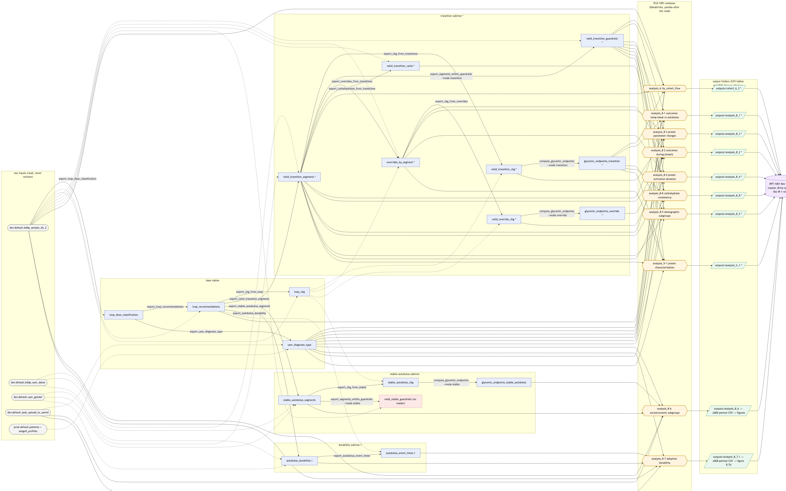
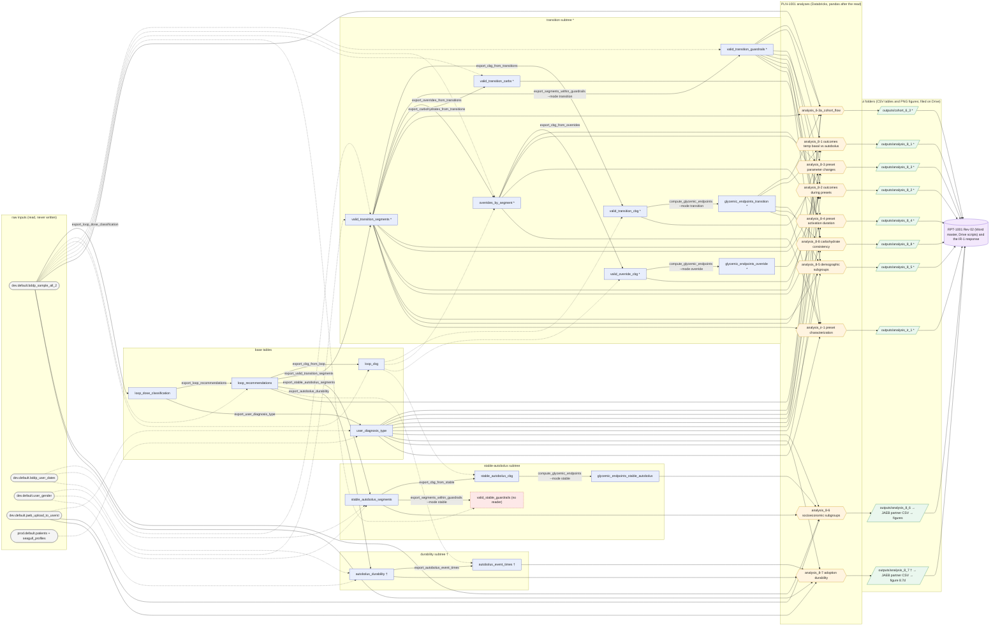
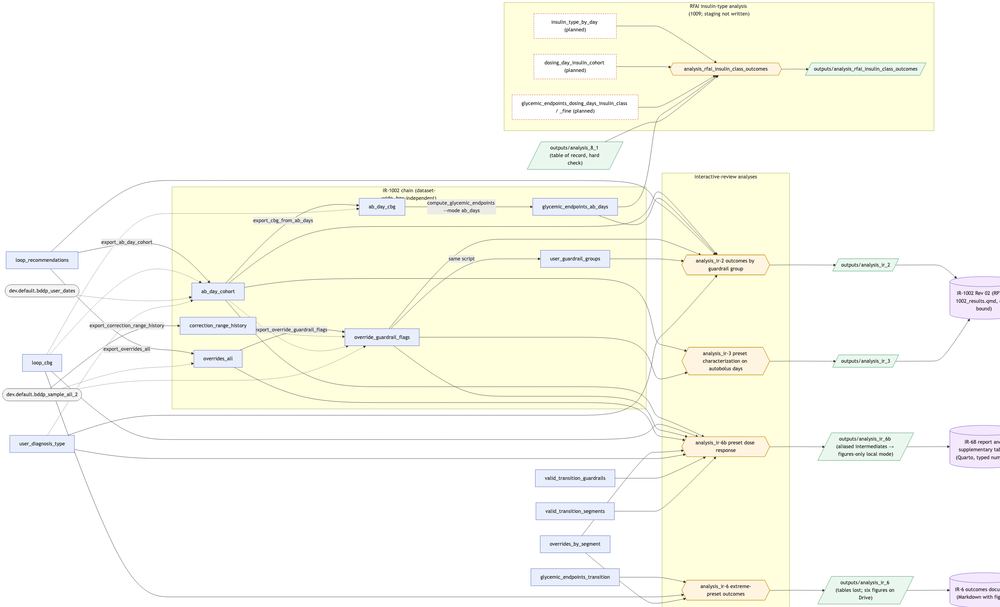
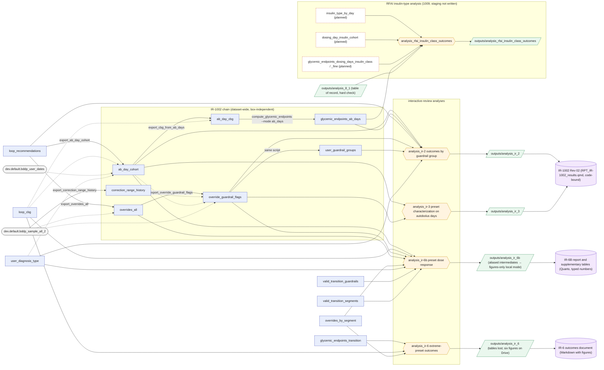
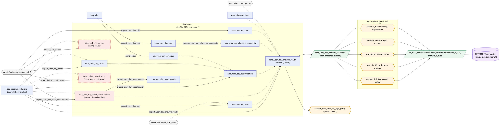
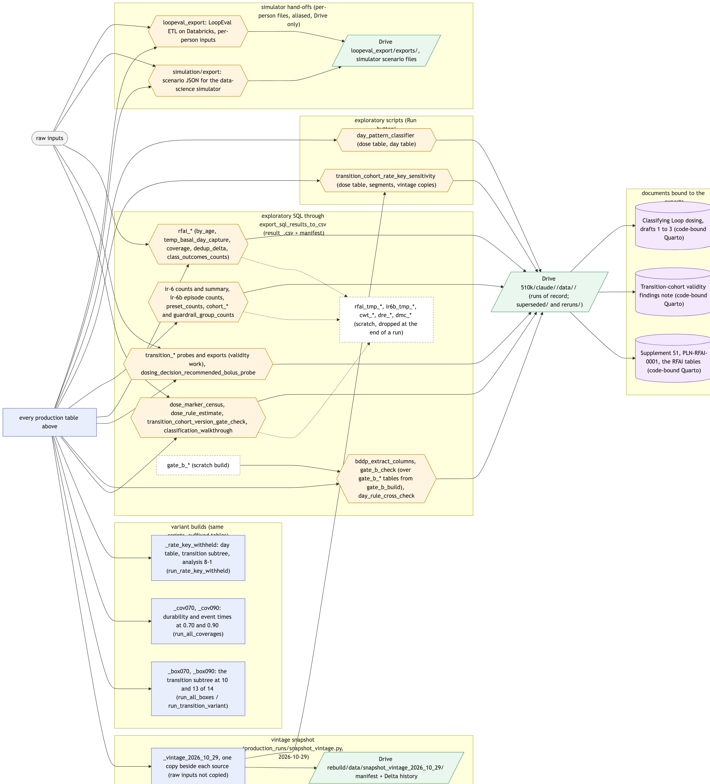
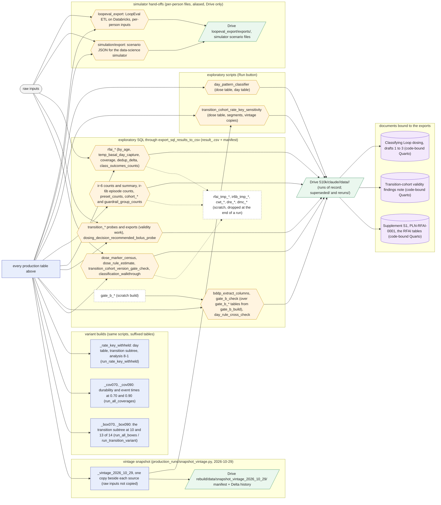
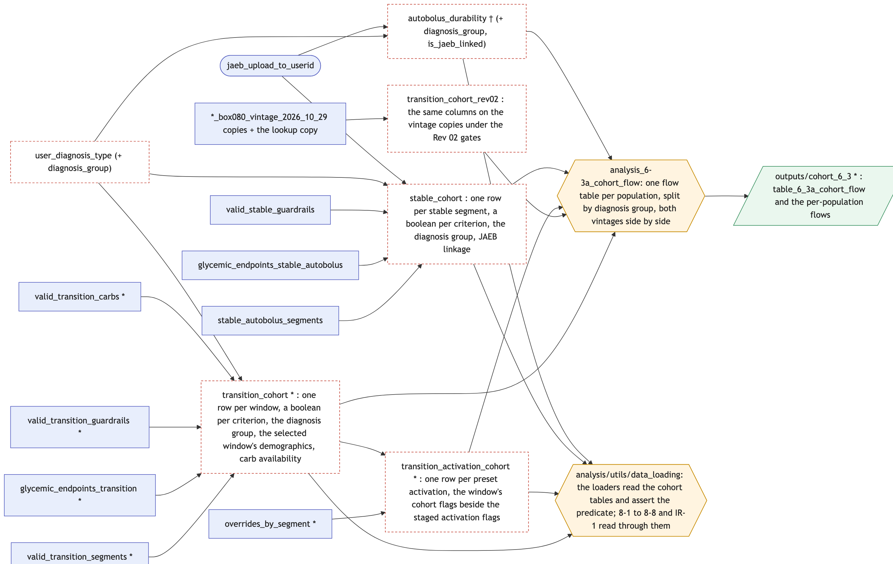
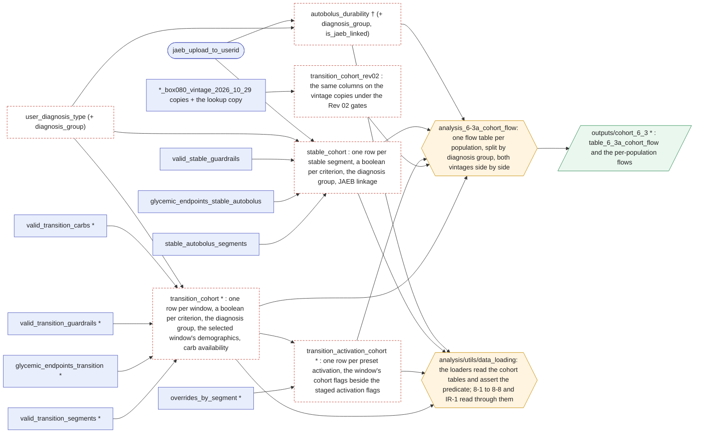

# Pipeline map: every table, export, and output behind the submission analyses

Built 2026-11-05 from the scripts themselves (each staging script's `output_table` default and the tables its SQL names; each analysis's `spark.table` and `spark.sql` reads; the exporter's job list; the snapshot manifest's table list), not from the project documents. It covers the PLN-1001 analyses, the interactive-review responses (IR-1002, IR-6, IR-6B), the RFAI insulin-type work, the PLN-1008 no-meal-announcement (NMA) chain, the exploratory exports, the vintage snapshot, and the simulator hand-offs. Section 6 lists the duplicated logic and the orphan tables the map exposes. Section 7 shows where the rebuild's cohort tables sit (dashed nodes), so no table is added where one already serves.

Reading the figures: a rectangle is a Databricks table in `dev.fda_510k_rwd` unless its name carries a catalog; a rounded node is a raw input; a hexagon is an analysis script; a parallelogram is an output folder or an exported file set; a cylinder is a document. An asterisk on a table name means the table is built once per window build (no suffix, `_box070`, `_box090`); a dagger means once per durability coverage build (no suffix, `_cov070`, `_cov090`). The script that writes a table labels the edge from its main input. The figures are rendered from the Mermaid source in this file by `docs/render_pipeline_map.py` (Quarto with Chrome) into `docs/figures/`.

## 1. Base tables and the PLN-1001 subtrees

## 2. The interactive-review chains and the RFAI analysis

## 3. The NMA (PLN-1008) chain

```mermaid
flowchart LR
  classDef raw fill:#f4f4f4,stroke:#888,color:#222
  classDef table fill:#e8eefc,stroke:#4f59be,color:#222
  classDef analysis fill:#fff4e0,stroke:#c78a00,color:#222
  classDef output fill:#eaf7ee,stroke:#2e8b57,color:#222
  classDef doc fill:#f3e8fc,stroke:#7046cc,color:#222
  classDef unused fill:#fde8e8,stroke:#c0392b,color:#222,stroke-dasharray: 4 3
  classDef dup fill:#fde8e8,stroke:#c0392b,color:#222

  bddp(["dev.default.bddp_sample_all_2"]):::raw
  dates(["dev.default.bddp_user_dates"]):::raw
  gender(["dev.default.user_gender"]):::raw
  day["loop_recommendations (the valid-day anchor)"]:::table
  cbg["loop_cbg"]:::table
  dx["user_diagnosis_type"]:::table

  subgraph NMAST["NMA staging (dev.fda_510k_rwd.nma_*)"]
    nage["nma_user_day_age"]:::table
    ncarbs["nma_user_day_carbs"]:::table
    ncev["nma_carb_events (no staging reader)"]:::unused
    nbc["nma_user_day_bolus_classification (its own dose classifier)"]:::dup
    nbce["nma_bolus_classification (event grain, not wired)"]:::unused
    nbcnt["nma_user_day_bolus_counts"]:::table
    ncbg["nma_user_day_cbg"]:::table
    ncov["nma_user_day_coverage"]:::table
    nend["nma_user_day_glycemic_endpoints"]:::table
    ntdd["nma_user_day_tdd"]:::table
    ncls["nma_user_day_classification"]:::table
    nar["nma_user_day_analysis_ready (aliased _userId)"]:::table
  end

  day -- "export_user_day_age" --> nage
  dates -.-> nage
  bddp -- "export_user_day_carbs" --> ncarbs
  day -.-> ncarbs
  bddp -- "export_carb_events" --> ncev
  day -.-> ncev
  bddp -- "export_user_day_bolus_classification" --> nbc
  day -.-> nbc
  bddp -- "export_bolus_classification" --> nbce
  day -.-> nbce
  nbc -- "export_user_day_bolus_counts" --> nbcnt
  cbg -- "export_user_day_cbg" --> ncbg
  cbg -- "same script" --> ncov
  ncbg -- "compute_user_day_glycemic_endpoints" --> nend
  bddp -- "export_user_day_tdd" --> ntdd
  day -- "export_user_day_classification" --> ncls
  nbcnt -.-> ncls
  ncarbs -.-> ncls
  ncov -.-> ncls
  day -- "export_user_day_analysis_ready" --> nar
  nage -.-> nar
  nbc -.-> nar
  ncls -.-> nar
  nend -.-> nar
  ntdd -.-> nar
  dx -.-> nar
  gender -.-> nar

  csv[/"nma_user_day_analysis_ready.csv (local snapshot, aliased)"/]:::output
  nar --> csv
  parity{{"confirm_nma_user_day_age_parity (pinned counts)"}}:::analysis
  nar --> parity

  subgraph NMAAN["NMA analyses (local, off the CSV)"]
    n81{{"analysis_8-1 NMA vs carb entry"}}:::analysis
    n82{{"analysis_8-2 by delivery strategy"}}:::analysis
    n83{{"analysis_8-3 TDD stratified"}}:::analysis
    n84{{"analysis_8-4 strategy × stratum"}}:::analysis
    nsupp{{"analysis_8-supp finding explanation"}}:::analysis
  end

  csv --> n81
  csv --> n82
  csv --> n83
  csv --> n84
  csv --> nsupp

  onma[/"no_meal_announcement/analysis/outputs/analysis_8_1..4, analysis_8_supp"/]:::output
  n81 --> onma
  n82 --> onma
  n83 --> onma
  n84 --> onma
  nsupp --> onma
  rpt1008[("RPT-1008 (Word master with its own build script)")]:::doc
  onma --> rpt1008
```

## 4. Exports, variants, the snapshot, and the simulator hand-offs

## 5. Table inventory

One row per table the current staging writes. "Read by" lists the staging scripts and analyses that name it. The exploratory SQL files are not listed per table; section 4 names them.

| Table | Written by | Inputs | Read by |
|---|---|---|---|
| `loop_dose_classification` | `export_loop_dose_classification` | `bddp_sample_all_2` | `export_loop_recommendations`, `export_user_diagnosis_type`, the sensitivity and pattern-classifier scripts, the cross-check SQL |
| `loop_recommendations` | `export_loop_recommendations` | `loop_dose_classification`, `bddp_sample_all_2` (dosing decisions for the version) | every subtree root, `export_cbg_from_loop`, `export_overrides_all`, `export_ab_day_cohort`, analysis 6-3a, IR-2, the NMA chain |
| `loop_cbg` | `export_cbg_from_loop` | `bddp_sample_all_2`, `loop_recommendations` | every `export_cbg_from_*`, `export_overrides_from_transitions`, `export_ab_day_cohort`, IR-6, IR-6B, the NMA cbg export, the simulator exports |
| `user_diagnosis_type` | `export_user_diagnosis_type` | `loop_dose_classification`, `patients`, `seagull_profiles`, `jaeb_upload_to_userid`, `bddp_sample_all_2` | every analysis loader, `export_ab_day_cohort`, the NMA analysis-ready export, IR-2, IR-6B |
| `valid_transition_segments` * | `export_valid_transition_segments` | `loop_recommendations`, `bddp_user_dates`, `user_gender` | the rest of the transition subtree, 6-3a, 8-1 to 8-5, 8-8, IR-1, IR-6B, the simulator exports, LoopEval |
| `valid_transition_cbg` * | `export_cbg_from_transitions` | `valid_transition_segments`, `loop_cbg` | `compute_glycemic_endpoints` (transition); all three periods since 2026-11-06 |
| `glycemic_endpoints_transition` * | `compute_glycemic_endpoints --mode transition` | `valid_transition_cbg` | 8-1, 8-5, 8-8, IR-1, the IR-6 cohort staging (its third-period rows), the loaders, the simulator exports, LoopEval |
| `valid_transition_guardrails` * | `export_segments_within_guardrails --mode transition` | `valid_transition_segments`, `bddp_sample_all_2` | the loaders (8-1 to 8-5, 8-8, IR-1), IR-6B |
| `overrides_by_segment` * | `export_overrides_from_transitions` | `valid_transition_segments`, `bddp_sample_all_2`, `loop_cbg` | `export_cbg_from_overrides`, 8-2, 8-3, 8-4, IR-1, IR-6, IR-6B |
| `valid_override_cbg` * | `export_cbg_from_overrides` | `overrides_by_segment`, `loop_cbg` | `compute_glycemic_endpoints` (override), 8-2 |
| `glycemic_endpoints_override` * | `compute_glycemic_endpoints --mode override` | `valid_override_cbg` | 8-2 (through `load_override_endpoints`) |
| `valid_transition_carbs` * | `export_carbohydrates_from_transitions` | `valid_transition_segments`, `bddp_sample_all_2` | 8-8 |
| `stable_autobolus_segments` | `export_stable_autobolus_segments` | `loop_recommendations`, `bddp_user_dates`, `user_gender` | `export_cbg_from_stable`, `export_segments_within_guardrails` (stable), 8-6 |
| `stable_autobolus_cbg` | `export_cbg_from_stable` | `stable_autobolus_segments`, `loop_cbg` | `compute_glycemic_endpoints` (stable) |
| `glycemic_endpoints_stable_autobolus` | `compute_glycemic_endpoints --mode stable` | `stable_autobolus_cbg` | 8-6 |
| `valid_stable_guardrails` | `export_segments_within_guardrails --mode stable` | `stable_autobolus_segments`, `bddp_sample_all_2` | **nothing** (8-6 applies no guardrail gate) |
| `autobolus_durability` † | `export_autobolus_durability` | `loop_recommendations`, `bddp_user_dates`, `user_gender` | `export_autobolus_event_times`, 8-7 |
| `autobolus_event_times` † | `export_autobolus_event_times` | `autobolus_durability`, `loop_recommendations` | 8-7 |
| `overrides_all` | `export_overrides_all` | `bddp_sample_all_2`, `loop_recommendations` | `export_override_guardrail_flags`, IR-6B, the IR-6 SQL |
| `correction_range_history` | `export_correction_range_history` | `bddp_sample_all_2` | `export_override_guardrail_flags` |
| `ab_day_cohort` | `export_ab_day_cohort` | `loop_recommendations`, `loop_cbg`, `bddp_user_dates`, `user_diagnosis_type` | `export_override_guardrail_flags`, `export_cbg_from_ab_days`, IR-2, IR-3, IR-6B, the RFAI SQL |
| `override_guardrail_flags`, `user_guardrail_groups` | `export_override_guardrail_flags` | `overrides_all`, `correction_range_history`, `ab_day_cohort`, `bddp_sample_all_2` | IR-2, IR-3, IR-6B |
| `ab_day_cbg` | `export_cbg_from_ab_days` | `ab_day_cohort`, `loop_cbg` | `compute_glycemic_endpoints` (ab_days) |
| `glycemic_endpoints_ab_days` | `compute_glycemic_endpoints --mode ab_days` | `ab_day_cbg` | IR-2, the RFAI analysis |
| `nma_user_day_age` | `export_user_day_age` | `loop_recommendations`, `bddp_user_dates` | `export_user_day_analysis_ready` |
| `nma_user_day_carbs` | `export_user_day_carbs` | `bddp_sample_all_2`, `loop_recommendations` | `export_user_day_classification` |
| `nma_carb_events` | `export_carb_events` | `bddp_sample_all_2`, `loop_recommendations` | no staging script (exploratory only) |
| `nma_user_day_bolus_classification` | `export_user_day_bolus_classification` | `bddp_sample_all_2`, `loop_recommendations` | `export_user_day_bolus_counts`, `export_user_day_analysis_ready` |
| `nma_bolus_classification` | `export_bolus_classification` | `bddp_sample_all_2`, `loop_recommendations` | nothing in staging; two exploratory scripts |
| `nma_user_day_bolus_counts` | `export_user_day_bolus_counts` | `nma_user_day_bolus_classification` | `export_user_day_classification` |
| `nma_user_day_cbg`, `nma_user_day_coverage` | `export_user_day_cbg` | `loop_cbg` | `compute_user_day_glycemic_endpoints`, `export_user_day_classification` |
| `nma_user_day_glycemic_endpoints` | `compute_user_day_glycemic_endpoints` | `nma_user_day_cbg` | `export_user_day_analysis_ready` |
| `nma_user_day_tdd` | `export_user_day_tdd` | `bddp_sample_all_2` | `export_user_day_analysis_ready` |
| `nma_user_day_classification` | `export_user_day_classification` | `loop_recommendations`, `nma_user_day_bolus_counts`, `nma_user_day_carbs`, `nma_user_day_coverage` | `export_user_day_analysis_ready` |
| `nma_user_day_analysis_ready` | `export_user_day_analysis_ready` | the `nma_*` tables above, `loop_recommendations`, `user_diagnosis_type`, `user_gender` | the CSV snapshot, the parity check |

Tables in the catalog (and in the 2026-10-29 snapshot) that **no current script writes**: `loop_recommendation_day`, `loop_recommendation_healthkit_day`, `valid_transition_segments_day`, `valid_transition_segments_healthkit_day`, `nma_user_day_master` (no producer anywhere in the repository); `loop_user_carbs`, `user_days_closed_loop` (`closed_loop_rwd_analysis/`), `loop_user_tir_unfiltered` (`power_analysis/`), `behavior_trace_candidates`, `behavior_trace_candidates_b` (`behavior_model/`, `forecast_uncertainty/`). None is read by any submission analysis.

## 6. What the map exposes: duplicated logic and orphan tables

Each item names where the same thing is computed more than once, or a table that nothing reads. The depth-first order (MC, 2026-11-05) resolves the PLN-1001 items first and carries the standard outward.

**Duplicated logic**

1. **The transition-cohort predicate** is applied in `analysis/utils/data_loading.py` (version gate, age gate, guardrails, CGM coverage, pairing, best window) and restated inline by analysis 8-2's Table 8.2a path (version gate without the age term, rank 1, a guardrail anti-join in PySpark), by IR-6B (an inline copy of the version gate), by the NMA analysis-ready export (its own version gate), and by eight exploratory SQL files held to the loader by drift tests. The rebuild's cohort tables carry the predicate once, as columns.
2. **The dose classifier** exists in the FDA dose table and again in `no_meal_announcement/data_staging/export_user_day_bolus_classification.py` (its own rules off the raw extract) and `export_bolus_classification.py` (event grain, never wired). The migration design of 2026-10-30 retires both in favour of the FDA dose table.
3. **The autobolus-day threshold** lives in the day projection and again in the NMA analysis-ready export (`MIN_AUTOBOLUS_COUNT = 3`).
4. **Starting glucose at preset activation** is staged on `overrides_by_segment` (`is_starting_glucose_in_range`, from `loop_cbg`) and recomputed by analysis 8-3 from `valid_transition_cbg` with the same 30-minute window and bounds. Two sources, one flag.
5. **The JAEB identifier join** (`jaeb_upload_to_userid` to `bddp_sample_all_2` on upload id) is written inline in analyses 8-6 and 8-7, and again in `export_user_diagnosis_type`.
6. **The age gate** (6 years) is a loader constant, is restated inline in analysis 8-6 against the stable segments, and is hard-coded in the durability staging's `is_age_eligible`.
7. **Demographics for 8-5** are taken from any segment row of the user, not from the selected window; the cohort table carries the selected window's age, gender, and years with diabetes once.
8. **Carbohydrate plausibility bounds** (1 to 150 g per entry) are literals in analysis 8-8; the carb-availability criterion belongs on the transition cohort table with the bounds as named constants.
9. **The stacked range bar** was drawn by nine functions across 8-1, IR-2, IR-6, 8-7, the RFAI outcomes, IR-6B, and three NMA analyses; `analysis/utils/figures.py` now draws it, and 8-1 uses it. The others move when next refreshed.
10. **The diagnosis-group rule** (type 1, type 1 with LADA label, LADA, type 2, other, unknown) is a SQL CASE in the exploratory files and a Python twin in the loader, pinned by a test; the lookup table itself does not carry the group.

**Orphan or unused tables**

- `valid_stable_guardrails` is staged in every production run and read by nothing.
- `nma_carb_events` and `nma_bolus_classification` are staged by scripts in the NMA chain and read by no staging script or analysis.
- The five legacy tables with no producer, and the four from other subprojects, sit in the same schema as the submission tables and were copied by the snapshot.

## 7. Where the rebuild's cohort tables sit (built 2026-11-05, not yet run on Databricks)

The durability population takes no new table: `autobolus_durability` already holds one row per user with a boolean per criterion, so it gains the diagnosis group and the JAEB linkage flag and is the cohort table. The activation cohort table carries keys and flags only; the activation parameters stay on `overrides_by_segment`.

## 8. Changes to make

Ordered as the depth-first pass takes them (MC, 2026-11-05: PLN-1001 first and set the standard, then the same standard outward, returning when a later analysis improves it). An item marked **MC** needs a decision; the default stated is the one taken until MC says otherwise.

**In the PLN-1001 pass**

1. Stage the cohort tables of section 7 and the Rev 02 counterpart; the loaders read them and assert the predicate instead of applying it. With that, the inline copies go: 8-2's Table 8.2a path, 8-3's starting-glucose recomputation, 8-5's any-row demographics, 8-8's carbohydrate literals, the age gate restated in 8-6 and in the durability staging, and the JAEB join written twice.
2. One constants module in `data_staging/` holds the cohort thresholds (the version cutoff and its date, the age floor, the CGM coverage floor, the carbohydrate bounds); the staging and the loaders import it. No threshold is typed twice.
3. `user_diagnosis_type` carries `diagnosis_group`; one SQL expression, imported wherever a diagnosis group is derived; the Python twin stays pinned to it. `load_type1_user_ids` retires, and every analysis reads the group from its cohort table.
4. **MC, default yes:** Table 8.2a takes the full cohort gate, the age term included. The 2026-07-30 decision to keep its numbers stable and disclose the deviation no longer applies, since every number regenerates on the corrected classifier.
5. Every analysis wipes its own output folder, and the analysis driver writes a manifest with the Workspace tree hash so a run of record names its code.
6. **MC, default keep:** `valid_stable_guardrails` is staged and read by nothing. Either analysis 8-6 applies it, as the transition analyses apply theirs, or its staging step is dropped. Default: it is carried as a column on `stable_cohort`, 8-6 keeps not applying it, and the flow table shows how many segments it would remove.
7. **MC, default change:** the 8-7 JAEB export carries an exact adoption date beside the partner's identifier. A date is quasi-identifying; the default replaces it with days since the user's first observed day, unless the partner's protocol needs the calendar date.

**When the standard goes outward**

8. **Built 2026-11-05 (evening).** The NMA chain reads the FDA dose and day tables (the 2026-10-30 migration design): its own bolus classifier, its strategy threshold, its version gate, and `export_bolus_classification.py` retired; `nma_bolus_classification` stops being staged (`nma_carb_events` is still written by `export_carb_events.py`, read by exploratory scripts only).
9. **Built 2026-11-05 (evening).** IR-6B's inline version gate reads the cohort table; IR-2's Table IR-2a is produced from the autobolus-day cohort table by the same flow code; the IR-2 and IR-6 stacked bars draw through `analysis/utils/figures.py`. Still to move: 8-7's, the RFAI outcomes', IR-6B's, and the NMA figures' stacked bars, when those reports are refreshed.
10. The remaining literals become named constants: 8-2's minimum of three paired groups per preset (open); the IR-6B episode-window geometry (named 2026-11-05 in `export_dose_response_episodes.py`); the NMA's plausibility bounds (open).
11. **Built 2026-11-06.** The transition CGM cut and its endpoints carry the third period, so IR-6's whole-period outcomes read the shared `glycemic_endpoints_transition` instead of recomputing the first two periods from the CGM table and cross-checking them; one endpoint computation per window (MC: "Go ahead and do that").

**Databricks housekeeping (MC's hand; nothing is dropped by the rebuild)**

11. The five legacy tables with no producer (`loop_recommendation_day`, `loop_recommendation_healthkit_day`, `valid_transition_segments_day`, `valid_transition_segments_healthkit_day`, `nma_user_day_master`) and their vintage copies can be dropped. The four tables from other subprojects belong in those subprojects' own schemas, so the submission schema holds only what the submission reads.
12. The `_box080` tables stay until the RFAI response is out (execution plan §5 item 9); the vintage copies stay until the parity gates have run on them.
